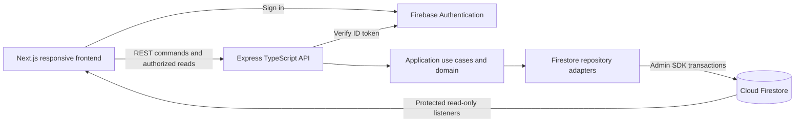

# Firebase with a TypeScript Express REST API

> **Live integration status (2026-11-05):** `jony-coria` has an empty Standard `(default)` Firestore database in `nam5`. The restrictive Firestore rules and seven composite indexes are present, and an Admin SDK read from the production API environment succeeded without seeding demo data. Cloudinary Free is the selected image provider. Public API/frontend hosting is not deployed. Sections below that still propose Santiago, Firebase Storage or manual payment approval are historical planning notes; the current implementation and production task record take precedence.

> **Current policy update (2026-11-05):** The user removed musician payment approval. A guest’s “Ya transferí” immediately enqueues the request in good faith, retaining capacity and without setting bank-verification timestamps. Receipt upload remains optional/private. There is no review queue, confirmation endpoint or overdue-review intake pause. Earlier manual-review requirements below are superseded by this decision; independent bank/API verification remains absent.
Working direction: Next.js/TypeScript frontend, Express/TypeScript REST backend, Firebase Authentication, and Cloud Firestore Standard. Firebase supplies identity, database/realtime infrastructure and private object storage for transfer screenshots. Express remains the authority for booking, pricing, payments, capacity, and tenant permissions. Mongoose is no longer part of the selected direction.

## Request and update paths



REST handles every business write. The web Firebase SDK subscribes only to explicitly permitted read models for the musician queue and guest's own status. The database is not publicly writable. Raw internal payment, audit, and identity records are never listener endpoints.

This is one repository with a modular backend, not a collection of microservices. The frontend and API may be deployed separately. Do not duplicate business operations in Next.js Route Handlers and Express controllers.

## Server structure

```text
apps/
  web/src/features/
    song-request/{domain,application,presentation}/
    musician-queue/{domain,application,presentation}/
  api/src/
    app.ts                       Express app, independent of hosting entrypoint
    middleware/                  auth, validation, errors, rate limits, CORS
    modules/
      requests/
        domain/                  request states, money, capacity policies
        application/             reserve, claim, confirm, perform
        controllers/             REST adapters and DTO mapping
        infrastructure/          Firestore repositories and transaction adapter
      musicians/
      catalog/
      shows/
      payments/
    composition/                 assemble concrete adapters
    entrypoints/                 local Node listener or Firebase HTTP wrapper
packages/
  contracts/                     safe DTOs, error codes, runtime validation
firebase/
  firestore.rules                client read permissions; deny business writes
  firestore.indexes.json         query indexes
```

Controllers validate input and identity, call use cases, and map responses. Use cases coordinate authorization and transactions. Domain code uses plain TypeScript and does not import Express or Firebase. Infrastructure implements focused persistence contracts using the Admin SDK. Use Zod or an equivalent maintained runtime validator for request contracts and persisted data; TypeScript alone does not validate JSON. Firestore has no Mongoose schema layer or general SQL uniqueness constraints.

## Identity and authorization

Musicians use the user-confirmed Firebase Auth email/password method, including verification and recovery. Guests are confirmed to have no signup, credentials or profile. The proposed internal mechanism uses Firebase Anonymous Auth only when private request access is needed. This creates a technical Auth identity but no guest profile or registration experience. Browsing the public menu need not create an identity. An anonymous identity is an access mechanism, not a newly required guest registration flow. Shared bar Wi-Fi signup limits need a pilot test. [Anonymous authentication](https://firebase.google.com/docs/auth/web/anonymous-auth).

The browser sends `Authorization: Bearer <Firebase ID token>` to Express. Middleware verifies the ID token using the Firebase Admin SDK, then derives the actor UID. Use cases map that actor to an active musician or the request's guest owner. Never trust a body/header `musicianId` as authority. Invalid/expired tokens return 401; valid identities without access receive a non-leaking denial. Reauthenticate for recipient changes; check revocation/account disablement on sensitive operations rather than assuming basic token verification does it. [Token verification](https://firebase.google.com/docs/auth/admin/verify-id-tokens).

Firebase's Admin/server SDK bypasses Firestore Security Rules. Therefore Express must enforce ownership on every operation, while Security Rules independently protect browser listeners. Denying a browser read is not evidence that the API is safe. Use a least-privilege runtime service identity, no service-account credentials in the frontend, and restrictive origins/CORS as a browser boundary rather than authorization. [Server access and rules](https://firebase.google.com/docs/firestore/security/rules-conditions).

Firebase Web SDK manages client authentication persistence. Do not build a second token store or put ID/refresh tokens in URLs, logs, query keys, or manually persisted UI stores. Next.js private screens can initially hydrate after client sign-in; public SSR requires no privileged session. If private SSR is later required, design Firebase session cookies explicitly, including CSRF protection. Cookie-authenticated mutation endpoints require CSRF protection; the bearer-token REST baseline never accepts cookies as an undocumented alternate authority.

Keep the existing private recovery link, storing only a server-side hash. A recovery endpoint verifies the capability, binds that single request to the new anonymous UID, rotates the capability, updates its read model atomically, and revokes the previous guest UID's access to that request. Never issue a musician token or expose other guest requests. Warn about changed-device access where needed.

## REST contracts

| Endpoint | Responsibility |
| --- | --- |
| `GET /api/v1/public/shows/:id/menu` | Public menu, price/version, availability summary |
| `POST /api/v1/shows/:id/requests` | Reserve a song atomically and return the committed quote |
| `GET /api/v1/requests/:id` | Own full request/payment instructions; also recovery/fallback read |
| `POST /api/v1/requests/:id/transfer-claims` | Guest declares transfer; never verifies money |
| `POST /api/v1/requests/:id/receipts` | Private screenshot upload through Express; never payment confirmation |
| `GET /api/v1/requests/:id/receipts/:receiptId` | Private authorized image stream to the guest or owning musician |
| `POST /api/v1/requests/:id/recovery` | Capability-based recovery into a verified anonymous session |
| `POST /api/v1/musician/requests/:id/payment-confirmations` | Authorized musician records actual received transfer |
| `PATCH /api/v1/musician/requests/:id/performance` | Legal playing/played/not-performed transition with expected version |
| `PATCH /api/v1/musician/shows/:id/queue-order` | Proposed musician-controlled reorder of confirmed queued songs |
| `GET /api/v1/musician/shows/:id/queue` | Authorized queue snapshot/fallback |

Profile/catalog/show/QR routes keep the behaviors in the technical plan, under the `/api/v1` base. All commands accept an idempotency key where duplicate effects are possible, and expected versions for conflicting edits. Errors use stable English codes with localized UI messages. Return 201 for creation, 409 for state/capacity conflicts, and appropriate authentication/validation/throttling statuses.

## Realtime without a second business backend

Publish small read models in the same Firestore transaction as canonical state changes:

- `musicianViews/{ownerUid}/shows/{showId}/queue/{requestId}`: queue/review status, song, relevant dedication, private receipt indicator, version. Only the active owning musician may read; no guest access.
- `guestRequestViews/{requestId}`: `guestUid`, song, own status, approximate position information if provided, version. Only the matching guest UID may read. Keep bank references, bank instructions, receipt files and audit data on authorized REST reads.
- Public menu responses contain no guest data. A separate public availability read model is optional if measured need justifies another listener; it is not required initially.

Rules deny all client business writes and all access to internal collections by default. Require owner identity plus active tenant membership for musician views, and exact guest identity for private request views. Query shapes must match rule constraints: rules do not filter an unrestricted query into safe results. No broad collection-group subscriptions. [Query security](https://firebase.google.com/docs/firestore/security/rules-query).

Firestore rules authorize whole documents, so do not put bank references in a listener document and expect rules to hide individual fields. Separate projections deliberately. Delete or mark terminal queue rows consistently so live listeners do not retain obsolete entries. Read models carry monotonically increasing versions and are rebuildable from canonical records.

The frontend subscription adapter feeds TanStack Query's existing canonical cache. Mutation overlays remain separate pending state. Do not poll a query that has an active listener, or keep another copy of the same queue in Zustand. REST remains the initial/fallback access path; listeners reconcile ongoing private changes. Public menus use focus/submit refresh and a proposed bounded 15-second refresh while visible, so live menu/cap edits appear without reprinting or rescanning. Clean up listeners on show switch, logout, hidden views, and terminal guest state. Clear private caches on identity changes.

Use snapshot metadata to distinguish cached/stale data from a fresh server response. Reconnection must not overwrite newer versions or turn an optimistic overlay into false payment success. If direct client listeners are later disallowed, REST polling is the fallback, but loses part of Firebase's realtime convenience.

## Transactions and the last available song

All reservation/payment/capacity writes are server-side Firestore transactions. Read the musician profile/settings and active-show guard, show, song allocation/count, route, identity relationships and idempotency records before any writes. Check availability and then atomically update capacity, song allocation, request, payment/audit, and read models. Retry callbacks may run again, so no bank calls, emails, or other external effects occur inside them. [Firestore transactions](https://firebase.google.com/docs/firestore/manage-data/transactions).

Use explicit document IDs and transactionally claimed reservation/uniqueness records for song codes, musician slugs, idempotency keys and bank transactions. Firestore indexes support queries; they do not replace MongoDB unique indexes. The technical implementation specifies counters and expiry behavior. Validate genuine contention against the selected regional database, in addition to Emulator Suite tests.

## Private transfer screenshots

Screenshot upload is included in the MVP. Proposed limit: one optional JPEG/PNG/WebP image per request, maximum 4 MiB and a bounded decoded pixel count. No OCR, automated bank matching or public receipt gallery. “Ya transferí” creates a claim even if an optional image upload must be retried.

Use an Express multipart endpoint with Firebase token verification, guest/request ownership and byte/time/rate limits. Validate actual image bytes, decode safely, re-encode and strip metadata; reject active formats such as SVG/HTML. Use generated private object keys in Cloud Storage for Firebase and store only object metadata in Firestore. Deny direct client bucket access; authenticated Express streams the image after checking exact request ownership or owning musician. No public download tokens/URLs, raw images in read projections, or images in logs.

Storage and Firestore writes are not one transaction. Reserve an idempotent upload record, write a validated object outside transaction callbacks, then transactionally attach its ready metadata after rechecking ownership. Reads expose only ready attachments. Retry/cleanup reconciles abandoned objects and stale upload records; repeated attempts cannot create unbounded attachments or confirm money. Guest recovery transfers request authorization, not public file ownership.

Proposed retention is 30 days after show end, with the operational policy set before the pilot and cleanup tested. File selection/progress/error lives in local UI state; the durable attachment metadata joins the canonical request cache only after acknowledgment. Upload failure preserves the request and declaration; success does not move the request into the confirmed queue.

Cloud Storage for Firebase requires Blaze billing. New-bucket no-cost storage allowances depend on region; do not assume São Paulo has US-region allowances. See [Firebase Storage billing requirements](https://firebase.google.com/docs/storage/faqs-storage-changes-announced-sept-2024).

## Musician profile media and social links

Public avatar/banner uploads are included in MVP, separate from transfer evidence. Store image bytes in a separate `profile-media/{musicianId}/...` namespace and metadata in `profileAssets`. Both namespaces deny direct client bucket access; only authorized Express code writes. Reuse bounded actual-image validation, decoding/re-encoding and metadata stripping, not receipt authorization. Proposed limits: 4 MiB avatar, 8 MiB banner and 20 megapixels decoded; produce bounded responsive derivatives and reject unsupported/active formats. No remote-URL image fetching or social-profile scraping is required.

Stage uploads with idempotency, validate and create image variants outside Firestore transaction callbacks, then publish a ready asset reference via the versioned profile save. Only the owning musician may stage, preview, attach, replace or remove their images. A publication transaction checks owner, asset kind/readiness and expected profile version. If upload/save fails, retain the last published asset; clean up orphaned staged files and retired variants with a retry-safe job. Profile media persists while referenced, independently of the receipt retention policy.

The public media route checks that an asset is the musician's currently published avatar/banner before serving a sanitized variant, with bounded cache lifetime and versioned URLs. Private preview requires the owner. Never use a general object-key proxy or fall back to a receipt path. Public media can be cached and copied; removal clears the profile reference and server access, while existing client/CDN caches may persist until expiry. No perpetual public download tokens.

Use an explicit public profile DTO containing stage name, bio, published asset URLs/focal points and opt-in contact/social fields. Do not serialize the internal musician document, authentication email, payment configuration or receipt metadata. The profile route remains available without an active show; the QR continues to resolve the active show/closed state and links to this public profile.

Normalize bounded social/website URLs server-side and permit HTTPS only; reject script/data URLs, embedded credentials and malformed links. Email/phone/WhatsApp fields use structured validation and generated contact links, not arbitrary URI input. Labels are plain text. Use safe external-link behavior, accessible platform names and no referrer from private request screens. Following occurs on the external platform; no guest accounts, social OAuth scopes, embedded feeds or follow database.

## Show ownership and direct arrangements

One permanent musician-owned QR resolves the musician's single active show; no per-table routing or guest table selection. The musician can update live repertoire and cap without reprinting, subject to existing commitments. Profile settings supply current prices and queue preferences. The pilot is one musician; keep isolation for future musicians.

The app records the musician's manual confirmation, not an independently verified bank result. Unfulfilled requests remain visible as not performed and direct the guest to speak with the musician. No refunds, disputes, repayment-detail collection or support-ticket workflows are implemented.

## Deployment

Export the Express app through a Firebase second-generation HTTP function, keeping its code compatible with ordinary Node hosting. Firebase documents wrapping a complete Express app in `onRequest(app)`. The API stays a REST API whether its process is hosted as a function or container. [Express on Firebase Functions](https://firebase.google.com/docs/functions/http-events).

Proposed production arrangement: Next.js frontend on Netlify's free allowance, Express on Firebase Functions, and Firestore near the function in São Paulo. Check current region support and cost before provisioning. Set minimum instances to zero for the cost-first pilot, cap instance growth for capacity planning, measure cold starts, and use budget/usage alerts. An instance cap is not a monetary spending cap.

Deploying Firebase Functions requires the Blaze billing plan. Included no-cost usage may cover a small pilot, but this is billing-enabled pay-as-you-go, not a guaranteed zero bill. External Express hosting remains technically possible, but would not remove the billing requirement for Firebase Storage screenshots. No zero-billing alternative has been selected. [Functions deployment requirements](https://firebase.google.com/docs/functions/get-started).

No application code, Firebase project, billing account, or deployment was created by this architecture update.

## Local demo handoff

As of 2026-11-05, the application runs without Firebase. Actual local REST routes are in `apps/api/src/app.ts`; shared DTOs are in `packages/contracts/src/index.ts`. Earlier route tables and module trees in this document describe the target architecture, not an assertion that every planned endpoint exists. The initial small backend uses one domain/application/infrastructure/controller structure, avoiding empty per-feature modules.

- Replace demo musician sessions with Firebase email/password sign-in, verification, password recovery and Admin SDK ID-token validation. Replace guest demo sessions with anonymous identity without exposing registration UI. Remove the demo token storage path from production.
- Map identities to musician ownership and complete onboarding/profile creation for additional musicians. The local seed and QR routing support Jony only; isolation tests today cover guests and the seeded musician, not multiple cloud tenants.
- Replace the aggregate JSON transaction adapter with scoped Firestore repositories and atomic reservation/active-show/queue writes. Do not serialize or fetch the whole cloud database. Define indexes, bounded pagination and server timestamps, and rerun last-slot/idempotency tests with the emulators.
- Move validated raster assets into separate public profile and private receipt storage paths. Preserve authorized receipt delivery, metadata stripping and limits; add lifecycle cleanup and request recovery capabilities.
- Replace current 5-second private and 15-second public polling with authorized listener projections and deliberate fallback behavior. Deploy and test Firestore/Storage rules independently of Admin SDK authorization.
- Configure a public domain for permanent QR links, allowed origins, secrets, budgets and deployment regions after the user creates their Firebase project. No Firebase keys or resource identifiers are currently required or stored.

Before a real show, finish physical iPhone/Android and weak-network checks, cloud rule tests, production auth/onboarding/recovery, retention and release review. Local build success does not approve production deployment. No automatic bank verification or Mercado Pago integration is implemented.
