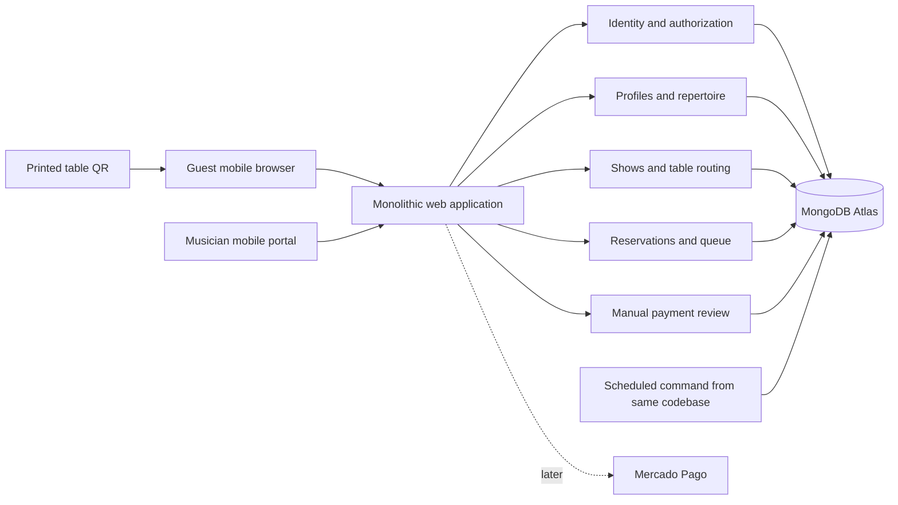

# Superseded MongoDB implementation reference

Historical reference only. Firebase/Firestore with an Express REST API now governs the current technical plan. MongoDB indexes, Mongoose sessions and old hosting choices below are not current implementation instructions.

Use one Next.js/TypeScript modular monolith with MVC controllers, Clean Architecture boundaries, and explicit frontend domain/application/presentation layers. MongoDB Atlas Free with Mongoose is the proposed low-cost persistence choice; database selection is not yet final. Server transactions own availability, capacity, and queue transitions. See [application architecture and optimistic state](APPLICATION-ARCHITECTURE.md) for the required layer contracts.

The working framework is Next.js App Router with TypeScript in the standard Node runtime. Thin Route Handlers/Server Actions call application use cases; domain rules do not import Next.js or Mongoose. Proposed hosting is Netlify Free plus Atlas Free, subject to quota/connection/load validation; a small paid Render Node service is the fallback. See [hosting](HOSTING.md). The previous [PostgreSQL plan](TECHNICAL-IMPLEMENTATION-POSTGRESQL-REFERENCE.md) is retained as an alternative reference, not a second implementation to build.

### Mobile first with tablet and desktop support

Design both guest and musician journeys from a 360 CSS-pixel phone layout, then adapt to tablet and desktop. Use responsive CSS and content-driven breakpoints, with representative checks at 768, 1024, and 1440 CSS pixels. Phone uses a clear single-column flow; wider screens may pair menu and order details or queue and selected request. Keep every feature available at every supported size. Support touch, keyboard, mouse, visible focus, zoom, screen readers, portrait/landscape tablets, and safe-area insets. Avoid hover-only controls and horizontal page overflow. Retain input, selection, and request identity across resizing or rotation. No separate mobile app or device-specific business logic is needed.

The first pilot is Jony in an Argentine bar. The data model supports other musicians without sharing their repertoire, payment details, or requests. The framework direction remains Next.js; [stack options](TECH-STACK-OPTIONS.md) retains the earlier comparison and current database status. This document specifies behavior and boundaries, not a deployed application or an approved architecture.

## 1. Scope and working defaults

| Concern | Proposed MVP behavior |
| --- | --- |
| Public customer | No account required; private browser session owns each request |
| Musician | Verified email/password account, profile, repertoire, payment details, and shows |
| Request | Exactly one song and one performance slot; either standard or dedicated |
| Prices | Two final ARS totals: standard price and dedicated-song price; dedication is not an ambiguous surcharge |
| Dedication | Required only for dedicated requests, 1–280 Unicode characters after trimming; plain text |
| Show capacity | Musician enters maximum request performances for that show; completed songs still consume capacity |
| Song availability | One performance per song per show by default; repeats and bundled dedications are deferred |
| Payment | Guest transfers directly to musician's alias/CBU; musician checks actual account credit |
| Unpaid hold | 10 minutes from server creation, bounded by request cutoff |
| Submitted transfer | Retains its slot until explicitly resolved; alert after 15 minutes, pause new intake while overdue |
| Queue | First verified payment first; manual queue reordering deferred |
| Locales | `es-AR` default; `en`, `pt-BR`, `it`, `fr`; last two await product confirmation |
| Currency and time | ARS only; integer centavos; UTC persistence and `America/Argentina/Buenos_Aires` display |
| Venue ownership | Each musician manages their own venue/table records; shared bar ownership/routing is later |

A musician's maximum request count excludes any planned personal set unless entered as unavailable capacity. For example, Jony can perform 30 songs but reserves 10 for his own set: he opens 20 request slots. The setup UI must explain this distinction. No time-of-performance guarantee is inferred from a queue position.

## 2. Application shape



Use feature modules for identity, musicians, catalog, shows, requests, and payments. Within each, controllers handle transport, use cases coordinate domain behavior, and infrastructure supplies persistence. Keep only purposeful ports and adapters; no generic repository framework or additional HTTP service is needed. See [source layout and dependency rules](APPLICATION-ARCHITECTURE.md).

Production needs one HTTPS Node service and one database. Request timestamps make expiry independent of process uptime. Optional housekeeping uses a bounded scheduled function from the same repository on serverless, or a restart-safe loop on the persistent Node fallback. A generated avatar keeps onboarding usable without adding file-storage cost; profile-photo uploads require durable object storage when enabled. Receipt uploads remain deferred.

## 3. Primary flows

### Guest

1. Scan table QR or open musician's public page. Resolve the current show and display musician, venue/table, show date, availability, and locale switcher.
2. Search/filter the repertoire available for this show. Display standard and dedicated totals before selection.
3. Choose request type; enter dedication only when needed. Show the full amount, reservation period, manual verification, and policy for a show that cannot fulfill the request.
4. Submit once. Server atomically creates the hold and immutable quote. Only the resulting checkout shows recipient, alias/CBU, exact amount, reference, and countdown.
5. Transfer in banking app; return and press **“Ya transferí”** with payer name and transaction/reference information available to the guest. This is a payment claim, not verification.
6. See **“Estamos verificando tu transferencia”**. After actual credit is verified, see **“Tu canción está en la fila”**, own request status and approximate position.
7. Follow `queued → playing → played`, or an explicit exception with an operator contact/reconciliation path. Guests cannot read another guest's dedication, name, transfer data, or status by guessing an ID.

### Musician

1. Register, verify email, create public profile, enter recipient display name and alias/CBU, and verify those details personally.
2. Add/edit songs or import a validated CSV; choose the musician’s standard and dedicated total prices.
3. Create a show with venue, timezone, start, request cutoff, capacity, repertoire subset, and confirmed payment destination; print/download table QR labels.
4. Open intake explicitly. The portal has separate **Transfers to review**, **Confirmed queue**, **Playing**, **Completed**, and **Exceptions** views with counts.
5. Check account credit outside the app; verify exact payment or record an exception. The app cannot read the bank account in the MVP.
6. Start and finish performances in verified FIFO order, disable new requests for a song, or pause intake.
7. Close intake and finish the show. Unperformed paid requests and unresolved transfers require visible reconciliation rather than disappearing into an archive.

## 4. MongoDB and Mongoose data model

Use separate collections for bounded aggregate records rather than one musician document with indefinitely growing requests. Every tenant-owned document carries `musicianId`; use cases load referenced resources within that scope. The database provides no SQL foreign keys, so repositories/use cases must explicitly verify musician, show, song, and table relationships inside the transaction. Clients cannot supply authoritative tenant identity.

| Collection | Essential fields |
| --- | --- |
| `users` | ID, normalized unique email, maintained authentication-provider credentials/session references, locale |
| `musicians` | ID, unique owner and public slug, public profile, two default ARS prices |
| `paymentAccounts` | Musician, stable receiving-account identity, version, recipient, alias/CBU, active flag |
| `venues` | Musician, name, timezone, `activeShowId`, revision used to serialize opening/closing a venue's active show |
| `venueTables` | Musician, venue, label, unique opaque QR token, enabled flag |
| `tableRoutes` | Unique table ID, musician, venue, current show ID, route version |
| `shows` | Musician, venue, status/times, capacity, two total prices, payment configuration, `mutationRevision`, queue sequence |
| `songs` | Musician, unique tenant song code, title, artist, tags, active flag |
| `showSongs` | Musician, show, song, enabled flag, title/artist and price snapshots |
| `guestSessions` | Secret hash, expiry, minimal ownership metadata; no guest account required |
| `songRequests` | Musician/show/show-song/table, guest session, recovery hash, status, `capacityRetained`, type/dedication, integer-centavo quote, recipient snapshot, deadlines, queue rank, version |
| `paymentClaims` | Musician/request, payer/reference, claim timestamp, correction history |
| `payments` | Musician/request, expected and observed amount, state, stable receiving-account identity and transaction ID where known, verifier, refund obligation/completion |
| `requestEvents` | Append-only transition/audit data, actor and time; avoid copying private text unnecessarily |
| `idempotencyKeys` | Unique scope/key, input hash, resource/outcome, retention deadline |

Mongoose schemas validate field shapes and values. Domain use cases validate allowed transitions and cross-document rules. Runtime request validation is separate. Use integer centavos with bounded safe-integer checks and UTC dates; retain `America/Argentina/Buenos_Aires` for show display. A dedication must be nonblank plain text of at most 280 characters for dedicated requests; standard requests carry none.

### Indexes and integrity

- Unique musician slug/owner, normalized email, `(musicianId, songCode)`, `(showId, songId)` in show songs, table QR token, table route ID, and idempotency scope/key.
- Partial unique `(showId, showSongId)` where `capacityRetained = true` prevents two consuming requests for one song. Use the same flag for held, reviewing, queued, playing, and played requests; terminal exceptions retain it only by explicit policy.
- Partial unique `showId` where request `status = playing`; partial unique `(showId, queueRank)` where rank exists. Indexes are database indexes created/verified before traffic, not merely Mongoose validation annotations.
- Partial unique `(recipientAccountKey, bankTransactionId)` when a stable bank ID exists; preserve account identity across configuration versions. No fabricated deduplication based on name/amount. Future provider IDs are scoped to provider account.
- Query indexes for tenant/show/status/queue rank, hold/review deadlines, and request audit history. Avoid unbounded regex scans of the whole catalog; scope and cap search results.
- Serialize show activation through the tenant-owned venue guard and active-show pointer; two opening requests cannot each assign a different active show. Route changes also validate venue ownership.
- No TTL index on requests, payments, or protected review claims. TTL is optional for disposable sessions and expired idempotency records after the documented retry window; delayed TTL cleanup never enforces a business deadline.

Payment-account edits create a new configuration version. An open show's destination change requires a paused, explicitly reviewed update for new requests. Existing quote/recipient/song/table/policy snapshots remain immutable. Archive referenced songs instead of hard deleting them.

A `unique` Mongoose field is an index declaration, not proof that validation prevents a race. All writes use tenant-scoped repositories and the transactional protocol below. See [Mongoose validation](https://mongoosejs.com/docs/validation.html) and [transactions](https://mongoosejs.com/docs/transactions.html).

## 5. Catalog and pricing

Provide an editable structured catalog, not only a menu image/PDF: the application needs song IDs and availability. Manual add/edit plus CSV import satisfy initial repertoire upload. The import template uses English headers: `song_code,title,artist,genre,active`.

CSV workflow: upload → parse bounded UTF-8 input → validate each row → preview additions/updates/errors → confirm atomic import. Proposed limits: 1 MB and 2,000 rows; unknown columns, including unsupported per-song prices, receive actionable validation errors. Never execute formulas. Escape formula-leading content when later exporting to spreadsheet software.

Use musician-owned `song_code` for idempotent updates. Exact code duplicates are errors; normalized title/artist similarities are warnings rather than silent merges. No import deletes omitted songs. Store musician/show prices as integer centavos after exact decimal parsing. Opening a show copies its two final prices to `showSongs`; per-song overrides can be added later without changing existing request snapshots.

During an open show, price changes apply to newly created requests only, with a new menu version. A guest who loaded an old menu receives `PRICE_CHANGED` and explicitly accepts the new amount before a hold is created. Existing holds retain the server quote until expiry. A song disabled for new requests does not cancel existing reservations or confirmed performances.

## 6. Permanent QR and live availability

Encode a stable first-party HTTPS URL such as `/t/{random_token}` in each QR; the pixels remain unchanged while the database routing and live page change. No external dynamic-QR subscription is needed. A QR conveys public context, not authorization or proof that someone is physically at the table.

`table_routes` explicitly selects the current show. The musician previews the destination before activating routes. Binding requires same musician and venue, enabled table, and an openable show. Do not automatically select “today's newest show,” which becomes ambiguous after midnight or for overlapping events. Keep table context on checkout; a stale browser submitting an earlier show receives `SHOW_CHANGED` and must refresh.

A public `/m/{slug}` page shows the musician's current open show. If multiple shows are published, let the guest choose venue/date rather than silently route them. A non-table link requires the guest to choose and confirm an enabled table currently assigned to that show. Return allowed table labels and opaque tokens from a show-scoped public table endpoint, then revalidate the selected table on submission. A table label supplied by the browser is never trusted as a routing authority.

Return `available`, `temporarily_reserved`, `already_requested`, `played`, `disabled`, `paused`, `full`, or `closed` as appropriate. Public counts may be shown; never expose private request rows. Disable checkout when the page is stale/offline, then let the server make the final decision after refresh.

MVP QR permanence is within a musician's venue/table namespace. The same physical bar rotating different musician accounts would need shared venue ownership and authorized route assignment; this is a separate extension. Do not promise that one musician can redirect another's table QR.

## 7. State and capacity rules

Keep performance/request state separate from evidence of money. A bank transfer is external to the database transaction and cannot be rolled back by cancelling a request.

| Request state | Meaning | Consumes a slot? |
| --- | --- | --- |
| `held` | Unexpired quote, waiting for transfer claim | Yes until server expiry |
| `review_pending` | Guest says transferred; musician checks credit | Yes, including overdue review |
| `queued` | Full matching payment verified; awaiting performance | Yes |
| `playing` | Current performance | Yes |
| `played` | Performance completed | Yes for the remainder of this show |
| `expired` | Unclaimed hold timed out | No |
| `cancelled` | Explicitly resolved before performance | No; money may remain a refund obligation |
| `exception` | Late/mismatched/duplicate payment or unfulfillable request | Explicit `capacityRetained` flag; default retain if already allocated |

For `exception`, record a structured reason and whether its previously allocated slot remains retained. The flag can only change inside the same show-guard transaction that evaluates capacity. This avoids forcing “money received but no slot” into the normal queue or releasing a paid slot invisibly.

Payment states: `awaiting_transfer`, `claimed`, `verified`, `not_found`, `mismatch`, `refund_due`, `partially_refunded`, `refunded`. A later electronic provider may add `pending`, `rejected`, `chargeback`, and provider-specific reconciliation details. Payments remain recorded after request expiry/cancellation.

Allowed common transitions:

```text
held → review_pending → queued → playing → played
held → expired
held → cancelled                         (guest confirms no transfer made)
review_pending → exception               (mismatch or uncertainty)
review_pending → cancelled               (explicit operator resolution)
expired/cancelled → exception            (later money discovered)
exception → queued                       (full payment and capacity re-acquired)
exception → cancelled + refund_due       (cannot perform)
queued → cancelled + refund_due          (musician cannot perform)
```

Do not allow a guest to cancel a claimed transfer and instantly reclaim capacity. Send it to review. Do not mark a performed request unperformed to make capacity available; a correction requires an audited operator action and never erases actual performance history.

### Reservation transaction

Use a replica-set MongoDB deployment and a Mongoose transaction with the same session on every participating operation. The shared `shows.mutationRevision` is the contention guard: every capacity/payment/performance mutation writes it inside the transaction before evaluating dependent state. Concurrent writers to the same show produce a write conflict; retry the entire transaction with a fresh snapshot and the same idempotency key. A read-count followed by unrelated document inserts alone is insufficient.

1. Validate guest session, bounded input and rate limits. Reuse the original operation key after retries; reject reuse with changed input.
2. Start the transaction and update the show guard. Load current show/route/song under that transaction and recheck tenant, venue, table and route version. Expire due unclaimed holds by transitioning them and clearing their capacity flag.
3. Check open/cutoff state, overdue reviews, accepted quote/menu version and guest unresolved-request limit. Count capacity-retaining requests and require count below capacity; also check the selected song.
4. Insert one request with `capacityRetained = true`, immutable quote/destination and deadline bounded by cutoff, plus initial payment and audit records. The unique song index is a second defense against prohibited repeats.
5. Store the idempotency result in the same transaction and commit. Return transfer instructions only after confirmed commit. Resolve duplicate keys or uncertain commit by reading/retrying the same operation identity; never create a replacement intent silently.

All capacity edits, expiry, verification, cancellation and performance changes use the show guard. Played requests keep their capacity flag. A late transfer can acquire a slot only through this same transaction. No network calls, email, or external refunds occur in a transaction callback that may rerun. Run statements sequentially within the session.

A route rebind touches both old/new show guards in sorted ID order before updating the route; recheck the binding and expected version and restart if the observed prior binding changed. Reservations touch their requested show guard then validate that route, and never follow a changed route automatically. Venue activation touches the venue guard before affected show guards in the common order. This prevents stale-route booking and write skew without pretending MongoDB has PostgreSQL row locks.

The framework must prove transaction/retry behavior on the chosen Atlas tier. Use a local replica set for integration tests, not a standalone MongoDB process or mocked Mongoose. Store bounded idempotency records and return explicit retriable errors if the retry budget is exhausted.

### Transfer claim and review

Claim submission uses the show-guard transaction and request version, verifies guest ownership and the hold deadline, then sets `review_pending`, `claimed_at`, and `review_due_at = claimed_at + 15 minutes`. Duplicate claims return the existing result. A claim received after expiry becomes an exception; do not revive capacity automatically.

At review deadline, retain capacity, flag overdue, and pause new intake. The musician verifies, investigates, or explicitly resolves the claim. Pausing is safer than collecting more transfers while reconciliation is unattended. A maintenance delay cannot skip this rule: new-reservation commands also check overdue reviews transactionally.

Verification requires recipient, currency, full amount, actual account credit, and transaction identifier when supplied by the bank. A receipt alone, payer name alone, or **“Ya transferí”** is insufficient. Record verifier, time, observed amount, and reference. If these do not match, record an exception; do not silently top up, discount, or accept a partial payment. Duplicate credits and overpayments remain visible for reconciliation/refund.

On verification, atomically change `review_pending → queued`, mark payment `verified`, and assign a monotonically increasing queue rank. FIFO is based on verified acceptance, not QR scan time or an unverifiable transfer claim. Store bank transaction time separately when known. Manual reordering is deferred; FIFO sequence is immutable in the MVP.

### Late money and refunds

A late verified transfer after expiry may find the song or last slot already allocated. Within the show-guard transaction, re-check show status, cutoff policy, song availability, and capacity. Only re-acquire if it can be honored and the guest accepts any changed arrangement; preserve the original price. Otherwise set a refund obligation and show the exception to both parties.

Manual refunds happen outside the app. Capture amount, operator, timestamp, and bank reference after execution; `refund_due` is not `refunded`. Retain the private request-status page with a **“Necesito ayuda con mi transferencia”** action after expiry/cancellation. It accepts a late claim/reference and creates an operator-visible exception in the musician portal; it never silently books capacity. The same view shows the operator resolution/reply. No external email/WhatsApp support channel is assumed. If bank details are needed for return transfer, collect them privately only for that purpose with access/retention controls.

For an ambiguous payment, never invent a settlement result. The operator may release capacity only through an explicit recorded decision acknowledging possible later credit; later credit must still enter the exception process. Partial refunds remain open until the obligation is satisfied.

## 8. Show lifecycle and queue behavior

`draft → open ↔ paused → intake_closed → finished`; a show may be `cancelled` with outstanding obligations retained. Opening requires verified musician contact, valid payment details, at least one enabled song, positive capacity, valid time window, and table routes as applicable.

- **Pause:** blocks new holds; honors existing unexpired quotes and claims. Resume requires overdue reviews resolved. It does not stop the musician performing already confirmed requests.
- **Close intake:** blocks new holds; existing valid holds may finish until their deadlines. The normal cutoff closes intake; it does not mean the musician has stopped performing.
- **Finish now:** closes unpaid holds, prevents new confirmations from entering performance automatically, and converts unplayed paid/claimed requests to visible exceptions for fulfillment/refund decisions. Warn with exact outstanding counts before committing.
- **Cancel show:** stops intake, records the reason, expires unpaid holds, and creates reconciliation/refund obligations for claimed or verified funds. Never bulk-mark these as refunded.
- **Playing/played:** explicit one-tap state changes with optimistic version checks. Only one song can be `playing`; retry of the same action is harmless.

Portal polls every 5 seconds while actively visible, with a queue version/ETag and error backoff. Guest status polls every 15 seconds; menu refreshes on focus and before reservation, with at most 30-second visible polling. Pause hidden and terminal views. Refresh immediately on foreground return. A **“Última actualización…”** indicator and manual refresh prevent false confidence during poor signal.

Use the explicit optimistic mutation and reconciliation policy in [application architecture](APPLICATION-ARCHITECTURE.md): instant feedback for every action, reversible metadata predictions, and pending-only UI for reservation/payment commitments.

Start with polling; server-sent events are an optional later optimization. Polling failures do not change server state. No offline payment confirmations, background auto-play, or service-worker caching of private queue/payment responses. A future installable PWA can cache only safe static assets.

## 9. HTTP contracts

Paths are illustrative; use framework-native routes/actions while retaining these semantics. Authenticated mutations use session cookies and CSRF protection. Guest mutations also require their session, CSRF/origin validation, and idempotency keys where effects can repeat.

| Method and route | Contract |
| --- | --- |
| `GET /m/{slug}` | Public profile and current published shows, no private bank metadata |
| `GET /t/{token}` | Resolve table context and current show, or inactive/closed state |
| `GET /public/shows/{id}/tables` | Enabled table labels/tokens assigned to this show, for direct-link selection |
| `GET /public/shows/{id}/menu` | Public song list, totals, remaining count, show/menu version, server time |
| `POST /public/shows/{id}/requests` | Body: song ID, type, dedication if any, table token if applicable, accepted price/menu version; creates hold |
| `GET /public/requests/{id}` | Requires guest ownership; own amount, state, deadline, recipient instructions while valid, approximate queue position |
| `POST /public/requests/{id}/transfer-claim` | Payer/reference fields; claim only, never payment approval |
| `POST /public/requests/{id}/help` | Owned request only; report late transfer or reconciliation issue into musician exceptions inbox, including after expiry; no automatic booking/approval |
| `POST /public/requests/{id}/cancel` | Unclaimed hold cancellation or claimed-payment review request |
| `GET/PUT /portal/profile` | Own profile, defaults and locale |
| `GET/POST/PATCH /portal/songs` | Tenant-scoped structured repertoire, archive rather than destructive deletion |
| `POST /portal/catalog-imports/preview` | Validated preview token, row errors, totals; no catalog mutation |
| `POST /portal/catalog-imports/{id}/commit` | Atomic explicit apply; idempotent import identity |
| `GET/POST/PATCH /portal/shows` | Own shows, dates, repertoire, capacity and payment configuration |
| `POST /portal/shows/{id}/open-or-pause` | Explicit command and expected version; authorization + lifecycle rules |
| `PUT /portal/tables/{id}/route` | Bind own table to own show in same venue; expected route version |
| `GET /portal/shows/{id}/queue` | Private queue/review/exception projection; version/ETag support |
| `POST /portal/requests/{id}/verify-payment` | Actual observed amount/reference, expected version; verifies and queues atomically |
| `POST /portal/requests/{id}/resolve` | Explicit exception/cancellation/refund command with reason and expected version |
| `POST /portal/requests/{id}/start-or-complete` | Legal state transition; duplicate-safe |
| `POST /portal/shows/{id}/finish` | Counts + expected version and explicit outstanding-obligation handling |

Return stable English machine codes plus localized user messages. Examples: `SHOW_CHANGED`, `SHOW_CLOSED`, `SHOW_PAUSED`, `CAPACITY_FULL`, `SONG_UNAVAILABLE`, `PRICE_CHANGED`, `HOLD_EXPIRED`, `REVIEW_REQUIRED`, `STALE_VERSION`, `IDEMPOTENCY_CONFLICT`. Use 401/403 for authentication/authorization, 404 for non-visible resources, 409 for conflicts, 422 for validation, and 429 for throttling. Do not leak another tenant's resource existence.

Creation response contains request ID, status, amount in centavos/currency, server time, deadline, and status URL. Display a countdown based on server time; the database deadline controls acceptance. After a timeout, retry the same idempotency key or fetch owned request status before presenting another transfer instruction.

## 10. Identity, privacy, abuse, and localization

Use a maintained Next.js-compatible authentication implementation with verified MongoDB adapter support, password hashing, email verification, recovery, secure session rotation, HttpOnly/Secure/SameSite cookies, and CSRF protections. Rate-limit login/recovery and sensitive payment-account changes; require recent reauthentication for changing recipients. Never store passwords or provider tokens in browser storage.

Guest access uses a high-entropy server-issued session cookie. UUIDs and short display references are not secrets. A separate high-entropy recovery capability restores one request on another browser; offer a private recovery link when reserving, store only its hash, exchange it for session access, and strip it from the visible URL/history. Use `Referrer-Policy: no-referrer`, redacted access logs, no third-party analytics on checkout/status, and `Cache-Control: private, no-store` for private responses.

Require ownership checks on every profile/catalog/show/payment/request endpoint, including imports and downloads. Expose a dedicated public projection, not a serialized internal ORM model. Escape dedication/name/CSV content; accept plain text only. Image upload checks include magic bytes, byte/pixel limits, re-encoding, metadata stripping, and safe generated filenames. Avoid receipt uploads until needed; if introduced, keep private objects with short-lived access and no public bucket URLs.

Limit one unresolved hold per guest/show, proposed 5 reservation attempts per minute per guest and a tunable IP threshold. Shared bar Wi-Fi makes aggressive IP blocking harmful; monitor and tune. Rate limits cannot prove physical presence; QR images may be shared. Escalate to an accessible challenge only when abuse warrants it. A musician can pause intake and revoke a compromised table token.

Persist minimal payer data, dedication, and audit metadata. Do not log dedication text, CBU, payer reference, guest recovery tokens, passwords, or credentials. Propose deleting dedications/payer notes 30 days after show resolution; financial/audit record retention requires a separately confirmed operational/legal policy. Open disputes suspend deletion of necessary evidence.

Use translation keys and English identifiers. Argentine copy uses natural voseo: **“Elegí una canción”**, **“Dedicá una canción”**, **“Ya transferí”**, **“Quedan 3 lugares”**, **“La fila está completa”**. Format money with the selected locale and explicit `ARS`; localize date/time, plurals, validation, email, and status copy. Locale selection persists without changing the show or losing a dedication draft. Do not translate song titles or guest dedication text automatically. Test long Portuguese/German-like expansion even though German is not an initial locale; the layout must tolerate translation length.

## 11. Mercado Pago extension

Keep the manual payment lifecycle independent of a provider implementation. Later add a focused provider integration that creates checkout, records provider references, and reconciles the resulting payment into the same capacity/queue rules. Do not implement a generic plugin system now.

For multi-musician direct collection, confirm the eligible integration product and seller onboarding model. Mercado Pago documents seller-specific OAuth tokens for marketplace checkout; using Jony's credential for every musician would not implement independent sellers. Marketplace commission is a separate business decision, not an MVP assumption. [Mercado Pago marketplace integration](https://www.mercadopago.com.ar/developers/en/docs/checkout-api-payments/how-tos/integrate-marketplace).

For the selected API family, validate the documented webhook signature, persist a deduplicated event, retrieve authoritative payment/order data server-side, and check seller, currency, full amount, and request reference. Browser return URLs cannot confirm payment. Retry reconciliation after transient failures and handle out-of-order updates. Mercado Pago currently documents distinct Preferences/Payments and Orders flows; choose one supported flow during implementation and do not mix their identifiers or status names. [Preferences payment notifications](https://www.mercadopago.com.ar/developers/en/docs/checkout-pro-preferences/payment-notifications), [Orders payment notifications](https://www.mercadopago.com.ar/developers/es/docs/checkout-pro-orders/notifications?scope=prod).

Store encrypted seller credentials server-side with scoped access, refresh/revocation handling, and rotation. Payment creation and provider calls use supported idempotency semantics; webhook acknowledgment follows durable receipt. A scheduled reconciliation process catches missed notifications. A provider approval after hold expiry still requires atomic capacity reacquisition or refund resolution. Delayed payment methods may be inappropriate for same-night fulfillment; evaluate them explicitly before enabling.

Provider sandbox tests, Argentine account eligibility, fees, refunds, dispute/chargeback states, and the exact API/SDK version are prerequisites for that later release. No production credentials, webhook integration, or live payment verification have been created in this planning task.

## 12. Delivery sequence and evidence

| Slice | Deliverable | Required evidence |
| --- | --- | --- |
| 0 | Product decisions, three architecture/interaction simulations, selected framework, references | Product selection and independent critique; current planning package is input |
| 1 | Musician registration/profile and catalog import | Tenant isolation, import preview/rollback, exact decimal pricing, mobile onboarding |
| 2 | Show setup, capacity, repertoire snapshots, printable stable QR | Correct routing across dates/midnight, disabled tables, closed/full states |
| 3 | Guest menu, hold, private request status | Concurrent last-slot and same-song races, duplicate retries, stale prices, expired holds |
| 4 | Transfer claims, verification, exceptions/refunds | Screenshot cannot approve; mismatch/late/double payment, overdue review, exact recipient snapshot |
| 5 | Musician queue, playing/completion, pause/finish | Two-phone conflicting actions, verified FIFO, played capacity, interruption/reconnect |
| 6 | Full locale coverage and pilot hardening | Physical iPhone/Android, keyboard/screen reader, enlarged text, poor signal, backup restore |
| Later | Mercado Pago seller onboarding and checkout | Provider sandbox, webhook authenticity/replay, missed event reconciliation, refunds |

Prioritize integration tests with a real MongoDB replica set and the chosen Atlas tier for last-slot contention; mocked models cannot establish transaction/write-conflict correctness. Exercise two guests racing for one slot, two verifications racing, expiry against claim, show finish against verification, and repeated idempotency keys with changed bodies. Assert tenant separation with at least two musicians and overlapping song/venue names.

Browser end-to-end coverage should include one complete standard request, one dedicated request, claimed-transfer review, performer completion, and late-payment refund resolution. Add targeted unit tests for price parsing, state transitions, locale formatting, and deadline boundaries. Accessibility and visual checks remain separate from functional success.

## 13. Deployment, observability, and operational limits

Use development, staging, and production environments with separate databases/secrets. Deploy one application artifact; run tracked database migrations once per release. Prefer additive migrations and a rollback-compatible application window. Set timeouts and bounded MongoDB connection-pool limits; measure latency from Argentina before selecting hosting region. Avoid an idle/sleeping production process during performances.

Health checks cover process and database connectivity. Structured logs use correlation IDs and non-sensitive request/show identifiers. Monitor request errors, reservation conflicts, unverified/overdue transfers, outstanding refund amounts, maintenance heartbeat, and queue refresh latency. Alert the operator for failures that threaten paid requests, not every harmless polling retry.

Run idempotent expiry/review housekeeping when the process is available, with due-state evaluation on transactional commands and relevant reads so sleeping/restarting cannot break correctness. Scheduled serverless maintenance or optional in-process maintenance on the paid Node fallback catches up after interruptions; do not buy a separate job service by default. See [low-cost hosting](HOSTING.md).

Withdraw the previous proposed five-minute-loss/one-hour-recovery guarantee for the cost-first MVP. Recommend Atlas's optional low-cost daily snapshot subscription, with restore rehearsal and explicit awareness of the latest successful snapshot time. Reconcile external transfers after restoration before resuming intake. Paid PITR is a later business choice, not a launch dependency imposed by this plan.

At an outage: stop accepting new transfers in the web UI, retain private state where safely readable, display stale status explicitly, and let Jony manage already-confirmed requests from the last trusted view while recording changes for reconciliation. Do not continue collecting payments via a cached menu. Keep a private operator runbook for outage, wrong recipient, account takeover, abandoned show, and refund reconciliation.

## 14. Decisions required before implementation

Finalize the Next.js dependency and hosting choices through the template's simulations/review gate. Validate with Jony: request-only capacity, no-repeat rule, dedicated total pricing, manual review workload, hold/review timing, recipient account, and cancellation/refund policy. Confirm Italian/French and whether the same physical venue QR must rotate across independent musicians in the first release. These choices are explicit defaults for planning, not claimed user approvals.
