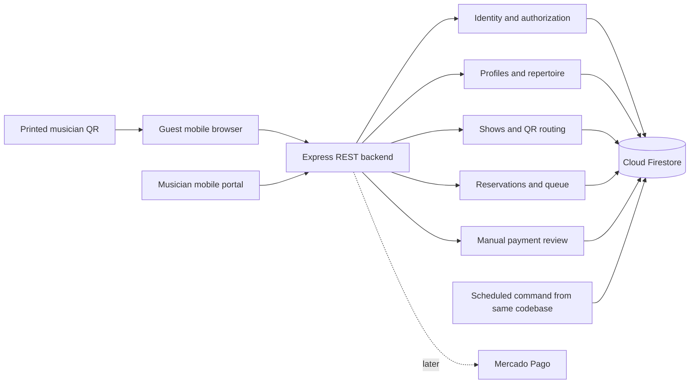

# Musica a la carta technical implementation plan

> **Capacity update (2026-11-05):** Per-song limits have been removed. Songs may repeat while total show capacity remains. En vivo offers plus/minus controls. The reduction floor is `max(committed requests, min(current capacity, played songs + 1), 1)`, so 7 played of 8 cannot be reduced to 7. The Express service enforces this in both persistence modes with version checks. Firebase writes a public, read-only show-capacity projection in the same transaction; guests subscribe to it and reconcile the full menu. The local demo polls every second. Earlier per-song-limit rules below are superseded.
> **Show scheduling update (2026-11-05):** The permanent musician QR selects the latest scheduled show whose Argentina start time has passed and whose 24-hour window remains open. A later show supersedes an earlier one; a finished latest show never falls back to an older draft. The server reconciles the show pointer on guest menu/reservation/claim and musician dashboard reads. Previous explicit-activation rules below are superseded.
> **Current policy update (2026-11-05):** The user removed musician payment approval. A guest’s “Ya transferí” immediately enqueues the request in good faith, retaining capacity and without setting bank-verification timestamps. Receipt upload remains optional/private. There is no review queue, confirmation endpoint or overdue-review intake pause. Earlier manual-review requirements below are superseded by this decision; independent bank/API verification remains absent.
Date: 2026-11-05. Status: engineering proposal for product and architecture selection.

Use a Next.js/TypeScript frontend and an Express/TypeScript REST backend with MVC and Clean Architecture. Firebase Authentication provides identity; Cloud Firestore Standard provides persistence and protected realtime read models. The backend stays a modular monolith in the same repository as the frontend, with two deployable entrypoints rather than separate domain microservices. The user selected the Firebase direction to reduce integration work.

All business writes go through Express use cases and server-side Firestore transactions. Client listeners receive authorized queue/status changes only. See [Firebase and Express](FIREBASE-EXPRESS.md) for identity, trust boundaries, endpoints, layers and deployment, and [optimistic state management](APPLICATION-ARCHITECTURE.md) for frontend reconciliation. Prior [MongoDB](TECHNICAL-IMPLEMENTATION-MONGODB-REFERENCE.md) and [PostgreSQL](TECHNICAL-IMPLEMENTATION-POSTGRESQL-REFERENCE.md) plans are alternatives only, not adapters to implement in parallel.

### Mobile first with tablet and desktop support

Design both guest and musician journeys from a 360 CSS-pixel phone layout, then adapt to tablet and desktop. Use Tailwind CSS v4 utility classes with mobile-first responsive variants and content-driven breakpoint choices, with representative checks at 768, 1024, and 1440 CSS pixels. Phone uses a clear single-column flow; wider screens may pair menu and order details or queue and selected request. Keep every feature available at every supported size. Support touch, keyboard, mouse, visible focus, zoom, screen readers, portrait/landscape tablets, and safe-area insets. Avoid hover-only controls and horizontal page overflow. Retain input, selection, and request identity across resizing or rotation. No separate mobile app or device-specific business logic is needed.

The first pilot is Jony in an Argentine bar. The data model supports other musicians without sharing their repertoire, payment details, or requests. The framework direction is Next.js plus Express; [stack options](TECH-STACK-OPTIONS.md) retains the earlier comparison and current database status. This document specifies behavior and boundaries, not a deployed application or an approved architecture.

## 1. Scope and working defaults

| Concern | Proposed MVP behavior |
| --- | --- |
| Public customer | No signup form; Firebase Anonymous Auth UID owns each request and its private status |
| Musician | Verified email/password account, profile, repertoire, payment details, and shows |
| Request | Exactly one song and one performance slot; either standard or dedicated |
| Prices | Two final ARS totals: standard price and dedicated-song price; dedication is not an ambiguous surcharge |
| Dedication | Required only for dedicated requests, 1–280 Unicode characters after trimming; plain text |
| Show capacity | Musician enters maximum request performances for that show; completed songs still consume capacity |
| Song availability | Musician-configured per-song performance limit; propose profile default 1, snapshotted into the show |
| Payment | Guest transfers directly to musician's alias/CBU; musician checks actual account credit |
| Unpaid hold | 10 minutes from server creation, bounded by request cutoff |
| Submitted transfer | Retains its slot until explicitly resolved; alert after 15 minutes, pause new intake while overdue |
| Queue | Musician-controlled ordering; propose verified-payment FIFO default with manual reorder of confirmed queued requests |
| Locales | `es-AR` default; `en`, `pt-BR`, `it`, `fr`; last two await product confirmation |
| Currency and time | ARS only; integer centavos; UTC persistence and `America/Argentina/Buenos_Aires` display |
| Show ownership | One active show per musician across all venues; one permanent musician QR, shared across tables |

A musician's maximum request count excludes any planned personal set unless entered as unavailable capacity. For example, Jony can perform 30 songs but reserves 10 for his own set: he opens 20 request slots. The setup UI must explain this distinction. No time-of-performance guarantee is inferred from a queue position.

## 2. Application shape

Use feature modules for identity, musicians, catalog, shows, requests, and payments. Controllers handle HTTP, application use cases coordinate domain behavior, and infrastructure repositories use the Firebase Admin SDK. Domain code is plain TypeScript. The separate Next.js presentation calls REST and receives read-only listener updates; it does not duplicate backend commands. Detailed layout is in [Firebase and Express](FIREBASE-EXPRESS.md).

Firebase Auth replaces password/session implementation; runtime schemas such as Zod replace Mongoose validation. Optional deadline maintenance runs bounded, retry-safe work from the API codebase. Correctness is checked on commands even if a scheduler is unavailable. Private transfer screenshots require Cloud Storage in MVP. Musician avatar/banner uploads are also included in MVP; generated initials and a neutral cover are fallbacks only. Keep public profile media separate from private receipts.

## 3. Primary flows

### Guest

1. Scan musician QR or open musician's public page. Resolve the current show and display musician, venue, show date, availability, and locale switcher.
2. Search/filter the repertoire available for this show. Display standard and dedicated totals before selection.
3. Choose request type; enter dedication only when needed. Show the full amount, reservation period, manual verification, and notice that unfulfilled requests are arranged directly with the musician.
4. Submit once. Server atomically creates the hold and immutable quote. Only the resulting checkout shows recipient, alias/CBU, exact amount, reference, and countdown.
5. Transfer in banking app; return and press **“Ya transferí”** with optional private screenshot, payer name and available reference information. This is a payment claim, not verification.
6. See **“El músico está revisando tu transferencia”**. After actual credit is verified, see **“Tu canción está en la fila”**, own request status and approximate position.
7. Follow `queued → playing → played`, or a truthful not-performed status directing the guest to speak to the musician. Guests cannot read another guest's dedication, name, transfer data, or status by guessing an ID.

### Musician

1. Register, verify email, create public profile, enter recipient display name and alias/CBU, and verify those details personally.
2. Add/edit songs or import a validated CSV; choose the musician’s standard and dedicated total prices and queue preferences.
3. Create a show with venue, timezone, start, request cutoff, capacity, repertoire subset, and confirmed payment destination; print/download their single reusable QR.
4. Open intake explicitly. The portal has separate **Transfers to review**, **Confirmed queue**, **Playing**, **Completed**, and **Exceptions** views with counts.
5. Check account credit outside the app; verify exact payment or record an exception. The app cannot read the bank account in the MVP.
6. Start and finish performances in the musician-selected queue order, disable new requests for a song, or pause intake.
7. Close intake and finish the show. Preserve unperformed requests and payment status for direct arrangement with the guest. The app does not manage refunds.

## 4. Firestore data model

Use Cloud Firestore Standard with explicit TypeScript domain objects, runtime validation and repository mapping. The Admin SDK does not enforce a Mongoose schema or SQL foreign keys. All relationships are validated against authenticated identity and document ownership inside use cases. Timestamps are server-controlled UTC; currency is ARS in bounded integer centavos.

| Collection or document | Essential data and purpose |
| --- | --- |
| Firebase Auth | Musician credentials, verification/recovery, anonymous guest identity; no password copies in Firestore |
| `users/{uid}` | Musician app preferences and account active flag; no guest profile documents or client-editable role authority |
| `musicians/{id}` | Owner UID, stage name/bio, avatar/banner asset IDs and focal points, explicit public contacts/social links, current song price and dedication add-on, settings version, catalog version, `activeShowId` guard |
| `paymentAccounts/{id}` | Musician, stable receiving-account identity, immutable configuration version, recipient/alias/CBU |
| `qrRoutes/{tokenHash}` | Owning musician, enabled/version and stable opaque public token mapping; resolves through musician active-show pointer |
| `shows/{id}` | Musician, venue display data, status/times, capacity, `occupiedCount`, `playingRequestId`, settings version, payment configuration, next queue rank, version |
| `songs/{id}` | Tenant/catalog revision, title/artist/code/tags, active flag |
| `shows/{showId}/songs/{songId}` | Song snapshot, enabled flag, `performanceLimit` and transactional `allocatedCount` |
| `requests/{id}` | Tenant/show/song, `guestUid`, recovery hash, status, capacity flag, quote/destination snapshots, deadlines, queue rank, version |
| `paymentClaims/{id}` and `payments/{id}` | Claim evidence, musician-recorded verification, optional bank reference, amount; no refund ledger |
| `profileAssets/{id}` | Owning musician, avatar/banner kind, generated object key/variants, dimensions/focal point, validation/publication state and version; separate from receipt assets |
| `receiptUploads/{id}` | Request/guest/musician identity, private object key, validation status and timestamps; no image bytes in Firestore |
| `requestEvents/{id}` | Append-only minimal actor/transition audit |
| `idempotency/{hash}` | Deterministic actor/operation/key identity, input hash, committed outcome |
| `uniqueClaims/{hash}` | Transactionally claimed slug, tenant song code, QR token or bank movement identity |
| Private read models | Musician queue and guest status projections described in FIREBASE-EXPRESS.md |

### Integrity and indexes

Firestore composite indexes accelerate supported queries, but do not enforce unique arbitrary fields. Use deterministic IDs and claim documents read/created in the same transaction as the corresponding business mutation. One song’s allocation count lives at its deterministic show-song path. One current performance is guarded by the show's `playingRequestId`. One active show across all venues is guarded by the musician’s `activeShowId`. Bank-movement claims use stable receiving-account identity plus a bank transaction ID, hashed into a safe document key; ambiguous movements remain unresolved.

Maintain `occupiedCount` transactionally whenever `capacityRetained` changes. Played requests keep their allocation/count. Counter consistency is verified against requests during tests and reconciliation; no client can increment or decrement it. Uniqueness records and idempotency outcomes cannot be asynchronously written after the business mutation.

Query indexes cover tenant/show/status/queue rank and due unclaimed holds. Deploy required indexes before release. Avoid unbounded collection scans and large indexed dedication fields. Security Rules deny browser access to internal collections and all browser business writes; test authorized view reads separately from API authorization because Admin SDK access bypasses rules.

Snapshot recipient, price, song, policy and locale when reserving. Recipient changes create configuration versions and affect future requests only; pause/review before changing an active show's destination. Archive referenced repertoire. No TTL deletion of money/request records or protected transfer claims. Due timestamps and domain transitions enforce expiry, not eventual document deletion.

## 5. Catalog and pricing

Provide an editable structured catalog, not only a menu image/PDF: the application needs song IDs and availability. Manual add/edit plus CSV import satisfy initial repertoire upload. The import template uses English headers: `song_code,title,artist,genre,active`.

CSV workflow: upload → parse bounded UTF-8 input → validate each row → preview additions/updates/errors → stage a complete merged catalog revision in bounded batches → validate all expected rows/claims → atomically switch the active revision pointer. An interrupted upload never exposes a partial catalog. Concurrent commits check the expected previous revision; staged data remains private and is cleaned up later. Proposed limits: 1 MB and 2,000 rows; unknown columns, including unsupported per-song prices, receive actionable validation errors. Never execute formulas. Escape formula-leading content when later exporting to spreadsheet software.

Use musician-owned `song_code` for idempotent updates. Exact code duplicates are errors; normalized title/artist similarities are warnings rather than silent merges. The staged revision includes unchanged existing songs; no import deletes omitted songs. Large imports and show snapshots must not exceed transaction/request limits; stage complete revisions and publish only after validation. Store prices as integer centavos: `standardPrice` is the song price, `dedicationSurcharge` is the additional dedication price, and the dedication total is their sum. Reservation transactions verify the total and snapshot both components and the final quote. Ordinary legacy `dedicationPrice` totals are converted to add-ons; a legacy total below the base price requires musician review and blocks new requests rather than silently changing the price. Per-song overrides are not required initially.

During an open show, price changes apply to newly created requests only, with a new menu version. A guest who loaded an old menu receives `PRICE_CHANGED` and explicitly accepts the new amount before a hold is created. Existing holds retain the server quote until expiry. A song disabled for new requests does not cancel existing reservations or confirmed performances. Proposed repeat limits and queue controls are profile preferences; public availability reflects their current show allocation.

## 6. Permanent musician QR and live show edits

Encode a stable first-party HTTPS URL such as `/q/{random_token}` in one musician-owned QR. All tables may use the same print. No external dynamic-QR subscription or per-table records are needed. The QR identifies public context, never private authorization or physical presence.

The route resolves its owner’s `activeShowId` after schedule reconciliation. A ready draft opens at its scheduled start automatically; the transaction updates the musician guard and show versions. If a later scheduled show starts, the prior show finishes and its unclaimed holds expire. Paused or closed intake can remain on the current show until the next scheduled show or its 24-hour window ends. A musician may open a show early as an explicit override.

The same printed QR resolves each scheduled show without reprinting. A reservation or transfer claim for an earlier show is rejected after the schedule changes. Existing private requests remain attached to their original show, quote and payment destination; completed or queued requests remain in history.

The musician may add catalog songs to the live menu, enable/disable future requests and increase capacity. Live settings and reservation writes share transaction guards; capacity cannot be lowered below occupied slots, nor a song limit below its allocations. Removing or editing menu content cannot erase existing requests. Profile price changes update new quotes only, with version validation and clear price-change feedback.

The public page displays current show/venue, prices, menu and available capacity. Existing screens refresh on focus, before reservation and through a bounded visible-menu refresh interval (proposed 15 seconds, suspended when hidden/offline); exact live queue/status uses private listeners. No promise that a stale displayed count authorizes payment. Only a successful reservation does.

## 7. State, reservations and manual payment review

Keep request/performance state separate from the musician's recorded payment confirmation. The system does not inspect bank settlement, process refunds or manage disputes.

| Request state | Meaning | Capacity |
| --- | --- | --- |
| `held` | Waiting for transfer claim, within server deadline | Retained |
| `review_pending` | Guest submitted a claim/screenshot; musician checks bank | Retained, including overdue review |
| `queued` | Musician confirmed payment; waiting to perform | Retained |
| `playing` | Current performance | Retained |
| `played` | Performance completed | Still counts toward nightly total |
| `expired` | Unclaimed hold expired | Released |
| `cancelled` | Explicit cancellation before performance | Release governed by transaction; prior payment record preserved |
| `not_performed` | Musician cannot fulfill; arrange directly | Previously committed allocation retained conservatively through show end |
| `needs_attention` | Late or mismatched claim | Existing allocation retained if present; does not acquire a new slot automatically |

Payment states are `awaiting_transfer`, `claimed`, `confirmed_by_musician` and `not_confirmed`. No `refund_due`, refund-completion, repayment-bank-details or dispute objects/endpoints in MVP. A screenshot never changes a payment to confirmed automatically.

### Transaction protocol

Firestore transactions read all dependencies before writes, including idempotency record, musician profile/settings and active-show guard, show state/capacity, QR route, show-song limit/count, request and relevant due holds. Use the authenticated actor and payload hash to bind an idempotency key; repeated requests return the original outcome, while changed payloads conflict.

For a reservation, calculate due unclaimed releases in a bounded set, validate show/context, current price/settings version, song availability/limit and capacity, then atomically update show/song counts, request, immutable quote/destination, audit and authorized projections. If cleanup is too large, finish bounded maintenance and retry. No external Storage/bank calls occur inside a transaction callback, which may retry.

For expiry, claim, cancellation, capacity changes, repeat-limit edits and payment confirmation, use the same show/request guards. A ten-minute unpaid hold and a fifteen-minute overdue-review alert/pause remain proposed operating defaults. A claim received in time retains capacity until the musician acts; expiry never silently releases it. Uploading a screenshot alone does not extend the hold; “Ya transferí” creates the claim, even if an optional upload must be retried.

Payment confirmation records musician UID/time and provided amount/reference after the musician checks the bank. Use receiving-account/reference uniqueness guards when an actual bank identifier is provided; missing or ambiguous references need human judgment, not automatic matching. A claim with expired capacity cannot enter the queue without an atomic capacity/availability recheck. If no capacity remains, display “Hablá con el músico para coordinarlo”; any alternative/refund is outside the application.

The profile owns repeat/queue preferences. Proposed controls are a per-song maximum (default 1) and payment-confirmation order with manual reorder of queued songs. Reorder uses an expected show queue version and updates a bounded set of queue ranks transactionally; unconfirmed, playing or played requests cannot be promoted through reordering. Every performance request consumes a slot even when the song title repeats. Raising/lowering limits never rewrites prior request history. Product intent is musician control; these particular controls remain implementation proposals.

Publish canonical state and private view projections in the same transaction. Read-model versions reject late snapshots overwriting newer state. No timeout or optimistic UI may manufacture a confirmed payment or slot. See [Firestore transactions](https://firebase.google.com/docs/firestore/manage-data/transactions).

## 8. Show lifecycle and queue behavior

`draft → open ↔ paused → intake_closed → finished`, with explicit cancellation. Only one unfinished active show may occupy a musician's active pointer. Opening requires a verified musician identity, valid recipient details, enabled repertoire, positive capacity and valid dates.

- Pause blocks new holds and preserves accepted requests/valid holds.
- Close intake blocks new reservations while allowing existing valid claims to complete.
- Finish/cancel warns about unplayed or under-review requests, stops new intake, releases only unclaimed holds and clears the musician active pointer transactionally. Use bounded batches for large state changes; new intake stays disabled during closing. Existing paid/claimed requests and private status remain accessible and are not silently marked played or refunded.
- The musician marks unfulfilled requests as not performed; guest and musician arrange directly. No refund workflow or required in-app resolution blocks finishing the show.
- Start/complete uses request/show versions and a single `playingRequestId`. Played songs continue to count toward total performed requests.

Protected Firestore listeners update the musician queue and each guest's own request. REST initial/fallback reads remain bounded; never poll private data while its listener is healthy. A stale indicator and reconnect handling preserve truthful pending states. Public menu refresh is separate and bounded as specified above. Use the [optimistic interaction policy](APPLICATION-ARCHITECTURE.md).

## 9. HTTP contracts

All API routes are under `/api/v1`. Musician and transparent guest identities are verified by Express through Firebase ID tokens; authorization remains in use cases. Public QR/menu reads require no registration. All mutations use expected versions/idempotency where relevant.

| Method and route | Responsibility |
| --- | --- |
| `GET /public/musicians/:slug` | Explicit published profile fields and ready media, independent of active show |
| `GET /public/musicians/:id/media/:assetId` | Serve only current published avatar/banner variants; bounded/cacheable public image response |
| `POST /musician/profile/assets` | Owner-authorized avatar/banner validation and staged upload |
| `GET /musician/profile/assets/:assetId/preview` | Owner-only staged image preview |
| `GET /public/qr/:token` | Resolve owning musician and active show or closed state |
| `GET /public/shows/:id/menu` | Current profile prices, show repertoire/capacity and versions; no private request data |
| `POST /shows/:id/requests` | Reserve with expected show/context/menu/settings versions, song and optional dedication; no table selection |
| `GET /requests/:id` | Guest-owned status and valid payment instructions |
| `POST /requests/:id/transfer-claims` | Record guest declaration, optional attached receipt ID; never confirms funds |
| `POST /requests/:id/receipts` | Authorized bounded image upload; private storage, retry-safe attachment |
| `GET /requests/:id/receipts/:receiptId` | Private image stream to originating guest or owning musician only |
| `POST /requests/:id/recovery` | Private capability recovery into the current anonymous session |
| `POST /requests/:id/cancel` | Cancel an unclaimed hold; a claimed transfer cannot silently free capacity |
| `GET/PATCH /musician/profile` | Own profile, public contacts/social links, ready avatar/banner references, prices, queue/repeat preferences and recipient settings; expected version |
| `GET/POST/PATCH /musician/songs` | Own repertoire; archive referenced songs |
| `POST /musician/catalog-imports/preview` and `/:id/commit` | Validated staged import and explicit commit |
| `GET/POST/PATCH /musician/shows` | Own shows and editable cap/repertoire; version checks |
| `POST /musician/shows/:id/activate` | Enforce musician-level single active show |
| `GET /musician/qr` | Download the stable musician QR |
| `GET /musician/shows/:id/queue` | Authorized queue snapshot/fallback |
| `PATCH /musician/shows/:id/queue-order` | Proposed musician reorder of confirmed queued requests |
| `POST /musician/requests/:id/payment-confirmations` | Record musician's manual bank check |
| `PATCH /musician/requests/:id/performance` | Playing, played or not-performed status; preserve payment record |
| `POST /musician/shows/:id/pause-or-close` and `/:id/finish` | Lifecycle transitions with outstanding counts and versions |

Use stable English error codes and localized messages, including `SHOW_CHANGED`, `ACTIVE_SHOW_EXISTS`, `CAPACITY_FULL`, `SONG_UNAVAILABLE`, `PRICE_CHANGED`, `HOLD_EXPIRED`, `STALE_VERSION`, `INVALID_RECEIPT` and `IDEMPOTENCY_CONFLICT`. Creation returns the immutable quote, request ID, server deadline and private status URL. An uncertain response is reconciled using the same idempotency key before another attempt. No refund/support-ticket endpoints are required.

## 10. Identity, privacy, abuse, and localization

Use Firebase Authentication for musician verification/recovery and transparent anonymous guest identities. Express verifies ID tokens, derives UID and checks active musician membership or guest ownership. Basic verification does not prove revocation has been checked; use explicit revocation/account checks for sensitive actions. Keep service-account/provider credentials server-side.

The Firebase Web SDK owns client auth persistence; don't build a second browser token store. Private request recovery exchanges a high-entropy capability through Express into ownership for the current anonymous UID, updates view permissions and rotates the capability atomically. Store only the capability hash and use no-referrer, sanitized logs and private no-store responses. A public QR or request ID never authorizes private access. Full contracts are in [Firebase and Express](FIREBASE-EXPRESS.md).

Require ownership checks on every profile/catalog/show/payment/request endpoint, including imports and downloads. Expose a dedicated public projection, not a serialized internal ORM model. Escape dedication/name/CSV content; accept plain text only. Image upload checks include magic bytes, byte/pixel limits, re-encoding, metadata stripping, and safe generated filenames. Include private screenshot uploads through the authorized Express API; see FIREBASE-EXPRESS.md for validation and object-storage lifecycle.

Limit one unresolved hold per guest/show, proposed 5 reservation attempts per minute per guest and a tunable IP threshold. Shared bar Wi-Fi makes aggressive IP blocking harmful; monitor and tune. Rate limits cannot prove physical presence; QR images may be shared. Escalate to an accessible challenge only when abuse warrants it. A musician can pause intake and revoke a compromised musician QR token.

Persist minimal payer data, dedication, and audit metadata. Do not log dedication text, CBU, payer reference, guest recovery tokens, passwords, or credentials. Propose deleting dedications/payer notes 30 days after show end; financial/audit record retention requires a separately confirmed operational/legal policy. Do not add a dispute-management subsystem; evidence retention/deletion policy remains operational setup.

Use translation keys and English identifiers. Argentine copy uses natural voseo: **“Elegí una canción”**, **“Dedicá una canción”**, **“Ya transferí”**, **“Quedan 3 lugares”**, **“La fila está completa”**. Format money with the selected locale and explicit `ARS`; localize date/time, plurals, validation, email, and status copy. Locale selection persists without changing the show or losing a dedication draft. Do not translate song titles or guest dedication text automatically. Test long Portuguese/German-like expansion even though German is not an initial locale; the layout must tolerate translation length.

## 11. Mercado Pago extension

Keep the manual payment lifecycle independent of a provider implementation. Later add a focused provider integration that creates checkout, records provider references, and reconciles the resulting payment into the same capacity/queue rules. Do not implement a generic plugin system now.

For multi-musician direct collection, confirm the eligible integration product and seller onboarding model. Mercado Pago documents seller-specific OAuth tokens for marketplace checkout; using Jony's credential for every musician would not implement independent sellers. Marketplace commission is a separate business decision, not an MVP assumption. [Mercado Pago marketplace integration](https://www.mercadopago.com.ar/developers/en/docs/checkout-api-payments/how-tos/integrate-marketplace).

For the selected API family, validate the documented webhook signature, persist a deduplicated event, retrieve authoritative payment/order data server-side, and check seller, currency, full amount, and request reference. Browser return URLs cannot confirm payment. Retry reconciliation after transient failures and handle out-of-order updates. Mercado Pago currently documents distinct Preferences/Payments and Orders flows; choose one supported flow during implementation and do not mix their identifiers or status names. [Preferences payment notifications](https://www.mercadopago.com.ar/developers/en/docs/checkout-pro-preferences/payment-notifications), [Orders payment notifications](https://www.mercadopago.com.ar/developers/es/docs/checkout-pro-orders/notifications?scope=prod).

Store encrypted seller credentials server-side with scoped access, refresh/revocation handling, and rotation. Payment creation and provider calls use supported idempotency semantics; webhook acknowledgment follows durable receipt. A scheduled reconciliation process catches missed notifications. A provider approval after hold expiry still requires atomic capacity reacquisition or refund resolution. Delayed payment methods may be inappropriate for same-night fulfillment; evaluate them explicitly before enabling.

Provider sandbox tests, Argentine account eligibility, fees, refunds, dispute/chargeback states, and the exact API/SDK version are prerequisites for that later release. No production credentials, webhook integration, or live payment verification have been created in this planning task.

## 12. Delivery sequence and evidence

| Slice | Deliverable | Required evidence |
| --- | --- | --- |
| 0 | Product decisions, three architecture/interaction simulations, selected framework, references | Product selection and independent critique; current planning package is input |
| 1 | Musician registration, profile media/contact/social editing and catalog import | Tenant isolation, import preview/rollback, exact decimal pricing, mobile onboarding |
| 2 | Show setup, capacity, repertoire snapshots, printable stable musician QR | Correct routing across dates/midnight, revoked QR and concurrent show activation, closed/full states |
| 3 | Guest menu, hold, private request status | Concurrent last-slot and same-song races, duplicate retries, stale prices, expired holds |
| 4 | Transfer screenshots, claims and manual confirmation | Screenshot cannot approve; mismatch/late/double payment, overdue review, exact recipient snapshot |
| 5 | Musician queue, playing/completion, pause/finish | Two-phone conflicting actions, configured queue order, played capacity, interruption/reconnect |
| 6 | Full locale coverage and pilot hardening | Physical iPhone/Android, keyboard/screen reader, enlarged text, poor signal, backup restore |
| Later | Mercado Pago seller onboarding and checkout | Provider sandbox, webhook authenticity/replay, missed event reconciliation, refunds |

Use Firebase Emulator Suite for API/rules integration and a staging Firestore project for actual contention/index/latency behavior. Race last-slot contenders against the Admin transaction implementation; mocked repositories cannot establish database guarantees. Exercise two guests racing for one slot, two verifications racing, expiry against claim, show finish against verification, and repeated idempotency keys with changed bodies. Assert tenant separation with at least two musicians and overlapping song/venue names.

Browser end-to-end coverage should include one complete standard request, one dedicated request, claimed-transfer review, performer completion, and unfulfilled request status and direct-arrangement message. Add targeted unit tests for price parsing, state transitions, locale formatting, and deadline boundaries. Accessibility and visual checks remain separate from functional success.

## 13. Deployment, observability, and operational limits

Use development, staging, and production environments with separate databases/secrets. Deploy the Next.js frontend and one Express backend entrypoint; track Firestore schema/index changes per release. Prefer additive migrations and a rollback-compatible application window. Set timeouts and bounded request/transaction time limits and managed SDK reuse; measure latency from Argentina before selecting hosting region. Measure serverless cold starts and regional latency before a live show; do not promise always-warm execution with minimum instances set to zero.

Health checks cover process and database connectivity. Structured logs use correlation IDs and non-sensitive request/show identifiers. Monitor request errors, reservation conflicts, unverified/overdue transfers, unperformed confirmed requests, maintenance heartbeat, and queue refresh latency. Alert the operator for failures that threaten paid requests, not every harmless polling retry.

Run idempotent expiry/review housekeeping when the process is available, with due-state evaluation on transactional commands and relevant reads so sleeping/restarting cannot break correctness. Bounded maintenance work catches up after interruptions; any chosen scheduler and its billing are explicit deployment choices; do not buy a separate job service by default. See [low-cost hosting](HOSTING.md).

The cost-first MVP does not promise five-minute data-loss or one-hour recovery guarantees. Firestore backups/restore are separate billable choices; the old Atlas $3 snapshot option does not apply. Define and rehearse the chosen Firestore recovery procedure, and reconcile external transfers before resuming after restore. See [hosting](HOSTING.md).

At an outage: stop accepting new transfers in the web UI, retain private state where safely readable, display stale status explicitly, and let Jony manage already-confirmed requests from the last trusted view while recording changes for reconciliation. Do not continue collecting payments via a cached menu. Keep a private operator runbook for outage, wrong recipient, account takeover, abandoned show, and direct arrangements outside the app.

## 14. Preparation before implementation

The Product Owner has settled guest access, manual review/screenshot upload, musician-owned QR, musician settings, direct outside-app arrangements and the one-musician/one-active-show pilot. Follow the team's existing prototype/review sequence without reopening these decisions. Runtime/hosting setup, receipt retention and budget remain operational preparation; exact prices are entered in the musician profile. Repeat limits and queue-control details are proposed implementations of musician control. Italian/French remain proposed additional locales.
